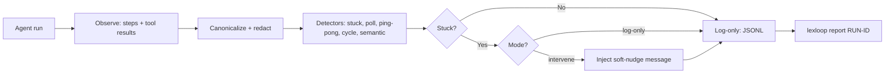

# LatticeAG LexLoop 🔁

<p align="center">
  <a href="https://github.com/LatticeAG/lexloop/blob/main/LICENSE">
    
  </a>
  <a href="https://github.com/LatticeAG/lexloop/actions/workflows/ci.yml">
    
  </a>
  <a href="https://github.com/LatticeAG/lexloop/stargazers">
    
  </a>
  <a href="https://github.com/LatticeAG/lexloop/issues">
    
  </a>
  <a href="https://github.com/LatticeAG/lexloop">
    
  </a>
  <a href="https://nodejs.org/">
    
  </a>
</p>

<p align="center">
  <b>The agent loop breaker. Watches runs, classifies stuck vs productive, injects a targeted nudge.</b><br/>
  Detector, rule classifier, and soft-nudge templates — usable fully offline.
</p>

<p align="center">
  <a href="#quick-start">Quick Start</a> ·
  <a href="#why-lexloop">Why LexLoop</a> ·
  <a href="#how-it-works">How It Works</a> ·
  <a href="#features">Features</a> ·
  <a href="#configuration">Configuration</a> ·
  <a href="#file-tree">File Tree</a>
</p>

---

LexLoop watches agent runs, classifies stuck vs productive loops with a belief-graph detector, and injects a targeted message to unstick the run. OSS and MIT: detector, rule classifier, soft-nudge templates, TypeScript SDK, CLI, golden corpus, and JSONL log. Hosted aggregate loop summaries are invite-only (summaries only, no transcripts).

Built by [LatticeAG](https://github.com/LatticeAG).

## Why LexLoop

- **Agents get stuck; bills grow** - polling loops, ping-pong tool calls, and repeated cycles burn tokens while making no progress. LexLoop detects the pattern and intervenes.
- **Classify before you nudge** - a belief-graph classifier distinguishes genuinely stuck runs from productive repetition, so healthy loops are left alone.
- **Soft nudges, not kills** - intervention injects a targeted message from versioned templates (`fixtures/interventions/tmpl_soft_v1.txt`), steering the run instead of terminating it.
- **Safe by default** - the SDK defaults to `log-only`; only `lexloop watch` defaults to `intervene`. Replays (`--from-jsonl`) are observe-only and refuse `intervene` with `LL4004`.
- **Redaction built in** - reports redact by default; `--no-redact` requires a TTY and `LEXLOOP_ALLOW_UNREDACTED=1`.

### How LexLoop is different

- **Belief-graph classification, not a step counter** - detectors cover stuck runs, polling, ping-pong exchanges, cycles, and semantic stalls, each with tuned thresholds (`min_run`, `window`, `min_cycles`).
- **Golden corpus + conformance** - `fixtures/golden` (loops vs productive) and `conformance/` (canonicalize parity, outcome cases) pin behavior; `lexloop bench golden` replays them.
- **Kit adapters, not framework lock-in** - wrap an OpenAI or Anthropic client in-process, or use the custom SDK integration. LangGraph users call `maybeInject` from a `before_model` hook with no `graph.attach()` magic.

## Quick Start

```bash
# 1. Prerequisites: Node >= 20.19 (CI matrix: 20.19 and 22), pnpm 9.15.0
git clone https://github.com/LatticeAG/lexloop.git
cd lexloop
pnpm install
pnpm --filter @latticeag/lexloop-cli build

# 2. Scaffold defaults
lexloop init        # writes lexloop.json defaults + creates .lexloop/
lexloop doctor      # node, config, .lexloop/, proxy, redact checks

# 3. Install @latticeag/lexloop in the agent project (e.g. pnpm add @latticeag/lexloop),
#    or link it into that project from this workspace. The child resolves its own imports.
#    Watch a run (default mode: intervene)
lexloop watch --cmd "node my-agent.js" --attach openai-completions

# 4. Replay offline (observe-only)
lexloop watch --from-jsonl .lexloop/events.jsonl

# 5. Report on a run
lexloop report <run-id>
lexloop report <run-id> --json
```

In v0.1, `watch --attach openai-completions|anthropic-messages|custom` prints setup hints only; it does not intercept requests or start a proxy. Instrument the child process itself: pass its OpenAI client to `lex.wrapOpenAI(client)` or its Anthropic client to `lex.wrapAnthropic(client)` and use the returned client.

For a custom integration, `observe()` records tool activity and detects loops; it cannot modify the model input. In intervene mode, call `maybeInject()` with the messages immediately before each model call and use the returned messages. `watch` selects intervene mode by default, but does not inject on its own.

LangGraph (custom kit — no `graph.attach()` in v0.1):

```ts
import { LexLoop } from "@latticeag/lexloop";
const lex = new LexLoop(); // SDK default mode: log-only
async function before_model(state: { messages: Array<{ role: string; content?: string | null }> }) {
  const messages = await lex.maybeInject(state.messages);
  return { messages };
}
// Observe tool results from a ToolNode wrapper with lex.observe(...).
// A first-class wrapLangGraph is later.
```

## How It Works



## Features

### Core Commands

| Command | Description |
|---------|-------------|
| `lexloop init [--force]` | Write `lexloop.json` defaults and create `.lexloop/`. |
| `lexloop watch` | Run a command with LexLoop env, or replay JSONL. Default mode `intervene`; `--from-jsonl` forces observe-only. |
| `lexloop report <run-id> [--json] [--no-redact]` | Print a run report (redacted unless TTY + `LEXLOOP_ALLOW_UNREDACTED=1`). |
| `lexloop config` | Validate, show, or set `lexloop.json`. |
| `lexloop bench golden\|detect` | Replay `fixtures/golden`, or run the synthetic detect-latency bench. |
| `lexloop doctor` | Check Node, config, local wiring, proxy port, and redact posture. |
| `lexloop version` | Print `0.1.0`. |

### Detection & Intervention

| Feature | Description |
|---------|-------------|
| **Stuck detector** | Flags runs repeating without progress (`detect.stuck.min_run`, default 3). |
| **Poll detector** | Catches polling-style tool calls via name regex + allowlist (`detect.poll.min_run`, default 8). |
| **Ping-pong detector** | Spots back-and-forth exchanges in a sliding window (`window` 12, `min_cycles` 3). |
| **Cycle detector** | Finds repeated action cycles (`min_cycles`, default 3). |
| **Semantic detector** | Flags semantically stalled runs even when surface actions vary. |
| **Budgets** | Caps spend per run (`budget` module). |
| **Soft-nudge templates** | Versioned intervention messages (`fixtures/interventions/tmpl_soft_v1.txt`). |
| **Redaction** | PII-aware log redaction; unredacted output needs TTY + `LEXLOOP_ALLOW_UNREDACTED=1`. |
| **Run log** | Append-only JSONL (default `.lexloop/events.jsonl`, 64 MiB cap). |

### Packages

| Package | Description |
|---------|-------------|
| `@latticeag/lexloop` | Public SDK (`LexLoop`: `observe`, `maybeInject`). |
| `@latticeag/lexloop-core` | Detectors, classifier, intervention, redact, budget, templates. |
| `@latticeag/lexloop-events` | Event schema + `@latticeag/events` bridge (`events-ext`). |
| `@latticeag/lexloop-config` | Strict zod config schema (`lexloop.json`). |
| `@latticeag/lexloop-cli` | The `lexloop` binary. |

## Configuration

`lexloop init` writes `lexloop.json` (strict schema — unknown keys fail). Key knobs:

| Key | Default | Description |
|-----|---------|-------------|
| `mode` | `log-only` (SDK) / `intervene` (`watch`) | `LEXLOOP_MODE` env overrides for `watch`. |
| `detect.stuck.min_run` | `3` | Repeats before a run counts as stuck. |
| `detect.poll.min_run` | `8` | Poll-pattern repeats; `allowlist` + `name_regex` tune matching. |
| `detect.pingpong.window` / `min_cycles` | `12` / `3` | Sliding window and cycle threshold. |
| `detect.cycle.min_cycles` | `3` | Repeated action cycles. |
| `log.path` / `log.max_bytes` | `.lexloop/events.jsonl` / `67108864` | JSONL path and 64 MiB cap. |

`.env.example` documents the env surface (`LEXLOOP_MODE`, `LEXLOOP_CONFIG`, `LEXLOOP_RUN_ID`, `LATTICEAG_*` session/event keys, upstream/proxy hooks). Do not use Node 23-only APIs — `engines.node` is `>=20.19`.

## Verification

```bash
pnpm install
pnpm --filter @latticeag/lexloop-cli build
pnpm test        # vitest run over packages/**
pnpm typecheck   # tsc --noEmit
```

Test suite (verified): **171 passed, 0 failed across 20 test files** — detectors, canonicalize (13), redact (14), budget, ids, signature, SDK attach/splice, events-ext schema, and config load.

## File Tree

```
packages/
  cli/            lexloop binary (init, watch, report, config, bench, doctor)
  core/           detectors + classifier + intervene + redact + budget + templates
  sdk/            public LexLoop SDK + kit attaches (openai, anthropic, splice)
  config/         strict zod schema + lexloop.json load/write
  events-ext/     event schema + toLattice bridge
bench/            golden.ts, detect_load.ts, stats.ts
fixtures/
  golden/         loops/ vs productive/ replay corpus
  interventions/  tmpl_soft_v1.txt nudge template
conformance/
  canonicalize/   axion-parity.json
  outcome/        cases.json
schemas/
.lexloop/         local run state (gitignored)
```

## Known Issues

- **No first-class LangGraph wrapper yet** - v0.1 wires via `maybeInject` in a `before_model` hook plus a ToolNode `observe` wrapper; `wrapLangGraph` is planned.
- **`packages/proxy/` is a placeholder** - empty in v0.1.0 (`.gitkeep` only); proxy-related doctor checks report `skip/ok` with proxy disabled.
- **Node 24 is untested upstream** - CI matrix is Node 20.19 and 22; this host runs Node 24 and passes, but 23-only APIs are still off-limits per `engines`.
- **Hosted aggregate summaries are invite-only** - OSS is the local detector + log; aggregates share summaries only, never transcripts.

## License

MIT — see [LICENSE](./LICENSE). Copyright 2026 LatticeAG.
